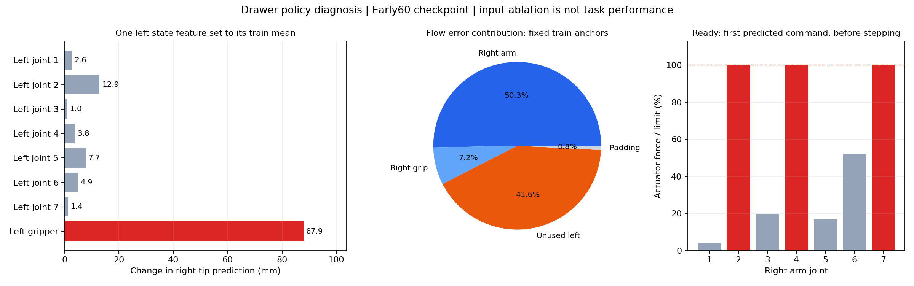

# 抽屉策略闭环失败：深入诊断与解决顺序

日期：2026-10-24，Asia/Shanghai。本轮仅阅读、统计、固定噪声推理消融和静态力矩计算，未训练新权重或修改数据/训练协议。

结论：目前不能把问题归结为“13条太少”。首动作在训练起点也不准确；同时发现无关左臂状态被过度放大、无关动作目标消耗大量损失、任务接口层完全冻结，以及错误位置目标触发执行器饱和等具体机制。纠偏数据不足会放大后续失败，但尚不能替代对首动作拟合问题的修复。

## 1. 已有证据排查到哪一步

- 初始状态和三路图像与对应数据首帧匹配；EGL/GLFW均已核查。
- 相同环境重放示教前4步，qpos误差为0。采集记录的动作是step前状态对应的本步位置目标。
- 两个train起点也失败，故不能只解释为validation场景陌生。
- 原2000及uniform/early60的短闭环记录均未抓到把手，错误在接触前已经出现。

这些结果降低了首帧加载、动作排列和短步物理回放错误的可能，不等于每一种软件或数据问题都已彻底排除。

## 2. 首动作不是一个本来就很难的动作

ready轨迹的右臂首个位置目标等于当前右臂位置；人工ID8也几乎如此。

| train起点 | 直接保持当前位置的首动作夹持点误差 | early60模型实际闭环首预测误差 |
|---|---:|---:|
| ID12 ready | 0 mm | 57.82 mm |
| ID8 human warm | 0.0184 mm | 12.15 mm |

这是首动作基准，不是可完成任务的策略；一直保持位置当然不会打开抽屉。
它证明优先要学好的内容包含“保留当前姿态并产生小而正确的变化”，而非一开始就解决复杂接触。
同一初始权重跨进程的推理结果有小幅数值差异，表中模型数值取已保存真实闭环。

## 3. 发现一：与任务无关的左夹爪读数能大幅改变右臂预测

在early60模型、train ID12首帧、固定seed42下，保持右臂状态、图像和任务文本不变：

- 只把左夹爪状态从0改为训练均值0.00106931rad（约0.0613度）。
- 右夹持点预测变化87.91mm。
- 在同一进程末尾重新输入原始观测，首动作逐项差异为0，排除了本次消融内的随机波动。
- 改左臂第2关节到训练均值，也使右夹持点预测变化约12.87mm。

这是人为输入干预，未改变物理状态或执行动作；说明该固定输入附近存在不合理的强依赖，并不直接证明它是全部失败的唯一根因。不能把此消融当成修复后的闭环成功。

原因线索来自归一化：左臂多个维度的std为1e-6～数e-6，物理上几乎不动的抖动被变成单位量级特征。左夹爪初始读数归一化约-5.89，随后几个物理步因自然 settling 变化明显。模型可能利用了这类与示教阶段偶然相关的信号；“用它当阶段捷径”仍是机制假设，敏感性本身已测到。

建议在新的实验版本中：将无关左臂状态在归一化后屏蔽为常量；训练和推理完全一致。左臂执行目标继续由确定的保持控制提供。不能只在旧模型推理时突然把输入归零并宣称问题已解决。

## 4. 发现二：约40%的诊断损失花在无关左臂

early60最终固定train检查帧的flow平方误差贡献：

| 维度 | 占总诊断损失比例 |
|---|---:|
| 右臂7关节 | 50.33% |
| 右夹爪 | 7.21% |
| 无关左臂与左夹爪8维 | 41.64% |
| 补零16维 | 0.81% |

validation中的左8维比例约39.94%。这些是固定诊断帧下的误差贡献，不是实测梯度贡献；不能直接说“40%的梯度被浪费”。但任务无关目标确实在优化目标中占有很大权重。

左8维比例按`(32*flow_all32 - 7*flow_right_arm - flow_gripper - 16*flow_padding)/(32*flow_all32)`，跨检查帧累加后计算。不是看维度数猜出来的。

建议做right8损失消融，右臂和右夹爪继续监督，左臂保持控制；不要错误断言padding占主导。
为隔离变量，首次可保留每个右侧维度的原权重，即`mean(error * right8_mask)`仍在32维上求均值；直接改为8维mean会把右侧每维系数放大4倍，须另记为优化尺度变化。

## 5. 发现三：当前冻结规则比上游更广

本项目`training_config.py`冻结所有不含lora的参数。以下接口层在本任务中都没有更新：

| 模块 | 参数量 | 当前可训练 | 上游模型LoRA过滤规则下可训练 |
|---|---:|---|---|
| state_proj | 33,792 | 否 | 是 |
| action_in_proj | 33,792 | 否 | 是 |
| action_out_proj | 32,800 | 否 | 是 |
| action_time_mlp_in | 2,098,176 | 否 | 是 |
| action_time_mlp_out | 1,049,600 | 否 | 是 |

这些层有预训练权重，不是随机未训练层。但更换机械臂、关节顺序、统计和动作含义后，让接口层也适配是合理候选方案。当前冻结范围不是上游要求；“冻结它们导致本次失败”仍需配对消融验证。

首选只额外解冻state_proj/action_in_proj/action_out_proj，合计100,384参数，保留视觉编码器冻结及现有LoRA。全部五层也仅3,248,160参数，但不宜第一次就全部变更。
从旧检查点续训时，新解冻层须转FP32再建优化器，避免对原BF16参数的小更新被量化吞掉。现有`check_freeze_rules()`只允许LoRA，需要按新实验白名单更新验收；不能只改过滤器就假定所有链路已适配。

参考上游原始实现：[Pi0Config.get_freeze_filter](https://github.com/Physical-Intelligence/openpi/blob/main/src/openpi/models/pi0_config.py)。本次同时实际检查了本地安装版本，并以抽象参数树核对了表中trainable状态。

## 6. ready起点是输入分布的稀有尾部

ready右臂第2关节约2.271rad，训练mean/std归一化后约8.06；到第30帧约4.06，第45帧约0.57。
它本身存在于train，不应称为“从未见过”或仅凭8个标准差就断言越界。
但原训练2000次更新只37次抽到各轨迹前15帧，起始高值区训练机会稀少。

固定图像下对右臂第2关节做±0.02rad输入探测：首输出第2关节局部增益，ready首帧约-0.026，第30帧约0.975；human首帧约0.921。
这不是普遍控制器应满足的增益规范，不能单凭它诊断“饱和”。它说明模型在起始区域的状态响应与后续区域明显不同，需重点拟合和检查。

把图像变黑会使输出夹持点变化约107～144mm；交换起点状态也会大幅改变输出。因此没有证据说模型完全忽略图像或状态。黑图和交换状态都是人为干预，也不能证明模型已经学会了正确视觉定位。

不建议简单把标准化值裁剪到[-3,3]：会合并本来不同的ready姿态。必要时单独比较物理关节范围缩放或合理std下限，并保留旧方案对照、使用独立统计版本。

## 7. 错误的绝对位置目标触发强物理响应

early60在ready首动作相对当前姿态，第2/4/7关节分别变化约-0.334/+0.288/-0.362rad。
仅设置这一位置目标并执行mj_forward（尚未推进物理），对应执行器力矩已达到-40/+27/-7Nm上限。
位置限幅只保证目标在关节范围内，不保证目标变化速度小。

4步即0.133秒，实际夹持点已相对同刻示教偏离92.77mm。对所有train帧做右7关节最近邻搜索：ready第4步最近训练姿态RMS距离约0.154rad，human第30步约0.284rad。
这支持轨迹快速偏离训练状态覆盖，但关节距离不是完整视觉OOD检测，也不是严格的分布外证明。

建议单独比较chunk=1与chunk=4，并对右7关节位置目标加入按示教速度标定的变化率限制。夹爪接触后的力控制目标应单独处理，不能一起按当前夹爪位置截断，否则会破坏持续夹持。
控制器保护只能约束错误动作的影响，不能代替正确策略；单步首目标本来就错，chunk=1也不保证解决问题。

## 8. 数据的问题是“有效覆盖”，不只是多少条

- 人工轨迹约29%～40%的相邻帧同时满足很小的臂指令变化和臂状态变化，其中包含等人操作和必要任务保持，不能全部删除。
- 人工轨迹开始实质臂运动的帧因轨迹而异，train约16～47，旧validation人工轨迹约84。
- 前75帧加权对不同轨迹含义不同；它既不等于完整接近段，更不等于抓握段。应利用实际运动、双侧组件接触和抽屉运动事件分阶段采样，并单列最初0～8帧。
- 目前示教主要是成功路线，未系统覆盖模型自己偏离后如何返回路线。

在起步拟合过关后，应该采真实偏离状态的恢复示教：复现模型若干步到失败附近，由人工/专家从那个状态接管，重新计算动作并完成任务。不要给偏离观测直接贴原示教时间点的动作标签。
恢复状态须保留qvel、ctrl、积分状态等，只有qpos不足以精确恢复；可从原完整初态重放已保存applied动作，再保存mjSTATE_INTEGRATION。

这是DAgger类方法处理“策略动作改变下一帧输入分布”的思路，并不保证少量新增数据立即成功：[Ross等，2011原始论文](https://arxiv.org/abs/1011.0686)。

开与关还可能存在相似姿态下方向不同的问题。本次找到一对拉/推帧，开度仅差0.144mm、右臂姿态RMS差0.028rad，但三路图像和状态不完全相同，不能断言严格不可辨识。历史观测/前动作或由实际观测更新的任务阶段可作为后续方案，不是本轮首步失败已确定的解释。

## 9. 建议的解决顺序与验收

### 第一阶段：做最小学习能力诊断

固定train ID12首0～8帧，使用各自真实未来16步标签，先做200步短拟合，每25～50步检查三种子；统计仍来自完整train，不在这9帧上重新估计微小std。

| 实验 | 相对前一实验只改变一项 |
|---|---|
| M0 | 现有LoRA-only配置，强制只学这9个起步帧 |
| M1 | 额外解冻三个I/O投影层，FP32更新 |
| M2 | 训练与推理共同屏蔽无关左臂标准化状态 |
| M3 | 排除左8维动作损失，保持右侧每维系数不变 |

上述是待执行方案，本轮没有训练这些模型。可根据M0/M1结果提前缩减无效分支，不必机械跑完所有组合。
建议诊断门槛：这9帧的三种子首动作位置最坏误差<2mm、姿态<2度，并报告右臂逐关节误差。它是拟合验收标准，不是已验证的物理抓握容差或泛化证据。
如果小样本训练帧仍学不准，应继续查接口适配、优化和动作表示，而不是继续扩充同类长轨迹。

### 第二阶段：必要时改右臂残差动作

当前学习绝对位置a。一个候选新版本是只对右臂7关节学习：

`delta_a[t,k] = a[t+k] - q[t]`，`a_pred[t,k] = q[t] + delta_pred[t,k]`。

整个16步块都以当前q[t]为基准，不能减未来q[t+k]。夹爪继续使用绝对目标，避免丢失顶住物体时的夹持指令。
残差变换必须在归一化前进行，重算train-only动作统计；输出先反归一化，再加一次当前状态。不能复用绝对动作统计或混读旧检查点。
残差有助于避免重新生成整套姿态，但偏置也可能积累；仍须经过同样闭环验收。

### 第三阶段：逐段扩大到13条并验证

1. 用第一阶段通过的最小配置，先学接近和抓握，再按事件平衡拉出/保持/推回/关闭。
2. 继续保留整条轨迹级validation，分组报告ready/human及首帧、接近、抓握、后续阶段，不能只报告总均值。
3. 先从两个train起点验证能否接近和抓握，再扩展3种子与validation；通过后运行完整时长的开关往返。
4. 若偏离后仍不能恢复，收集有针对性的接管/恢复数据；若在拉推阶段反复选错方向，再比较历史状态或可观测阶段条件。
5. 每次只改变一个实验因素；控制器限速、chunk和模型训练改动分开记录。原生loss仍每100步刷新，但以固定动作误差和真实闭环作为验收。

## 10. 本轮产物

- `data_and_objective.json`：13条数据的起步、停顿、归一化与损失贡献。
- `freeze_audit.json`：本地抽象参数树的冻结核查。
- `conditioning.json`：四个观测点的图像/状态消融与状态局部敏感度。
- `left_components_repeat_checked.json`：逐维左状态消融，同进程原输入复测差异0。
- `initial_actuator_force.json`：错误首目标对应的初始执行器力矩饱和。
- `rollout_state_coverage.json`：实测轨迹到所有train姿态的最近邻距离。
- `pull_push_aliasing.json`：拉/推近似观测对，标注为后续风险而非已证实根因。

固定噪声探测脚本：`scripts/a2_pi0/probe_drawer_conditioning.py`。
绘图：系统Python运行`python3 scripts/a2_pi0/plot_drawer_deep_diagnosis.py`。
