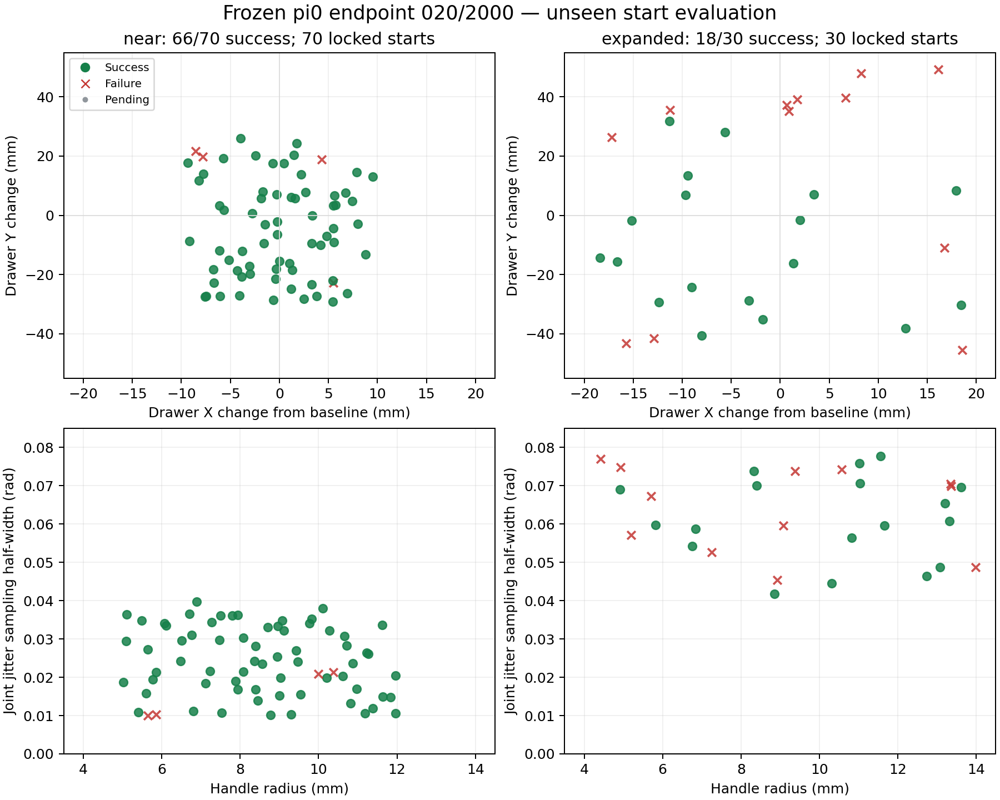

# 冻结020模型：全新100起点评估

完成时间：2026-11-02T10:51:37.281093+08:00

同一份020/2000权重，评估前锁定70个原范围组合起点和30个扩大范围起点。没有训练、专家标签或按结果筛选起点。

| 分组 | 成功 | 成功率 | Wilson 95%区间 |
| --- | ---: | ---: | --- |
| 原范围组合70 | 66/70 | 94.3% | 86.2%–97.8% |
| 扩大范围30 | 18/30 | 60.0% | 42.3%–75.4% |
| 合计100 | 84/100 | 84.0% | 75.6%–89.9% |

独立重放证据有效：100/100；权重、输入清单与运行源码指纹已核对。

## 运行条件与边界

沿用原严格判据：双指各>.01N持续5步、有接触拉动、开度≥80mm保持30步；open任务，24秒上限，固定噪声42，H4，continuous夹爪，checkpoint原精度，GLFW软件渲染，每条独立进程。推理时仿真暂停。

near：X偏移.09–.11m、Y±.03m、把手半径.005–.012m、关节扰动半宽.01–.04rad。
expanded：X偏移.08–.12m、Y±.05m、把手半径.004–.014m、关节扰动半宽.04–.08rad。X基准偏移为.10m；实际关节扰动受物理限位约束。

每个起点同时随机组合多个因素；expanded不是单因素消融。70/30的合并率只代表预定混合比例。新起点共享原模拟器和ready姿态来源，不能推断真机或任意场景成功率。

## 失败分布

- near: {"single_finger": 3, "grasp_slip": 1}
- expanded: {"no_contact": 1, "single_finger": 11}

`single_finger` 是原评分脚本的分类名，表示没有达到连续5步双指各>.01N的有效抓取条件，不表示整段过程中始终只有一指接触。6条失败（210、246、254、294、296、298）的峰值开度已超过80mm，但抓取判据未通过，因此仍计失败；没有用开度替代完整判据。

本轮100条的独立重放位置、速度、接触力最大误差均为0；专家执行动作与中途状态注入均为0。模型权重的21个推理文件前后SHA256一致，起点及运行源码指纹检查通过。没有继续训练模型，也没有挑选其他检查点。

## 起点与结果分布

绿点为成功，红叉为失败。完整参数和结果可下载 [CSV](starts_and_outcomes.csv)，图可下载 [PDF](start_distribution.pdf)。图中关节扰动是采样半宽，实际各关节扰动还受关节限位约束。

本轮说明模型在基准附近的新组合上多数能完成任务，但扩大范围后成功率下降。多个因素同时变化，本轮结果不能单独归因于某个位置、把手半径或关节扰动。

## 逐条结果

| ID | 组别 | 成功 | 峰值开度mm | 失败类型 |
| --- | --- | --- | ---: | --- |
| 200 | near | True | 102.42 | — |
| 201 | near | True | 101.50 | — |
| 202 | near | True | 102.44 | — |
| 203 | near | True | 101.22 | — |
| 204 | near | True | 101.04 | — |
| 205 | near | True | 100.51 | — |
| 206 | near | True | 98.60 | — |
| 207 | near | True | 101.95 | — |
| 208 | near | True | 100.90 | — |
| 209 | near | True | 100.91 | — |
| 210 | near | False | 93.16 | single_finger |
| 211 | near | True | 101.82 | — |
| 212 | near | True | 100.74 | — |
| 213 | near | True | 102.11 | — |
| 214 | near | True | 95.04 | — |
| 215 | near | True | 101.85 | — |
| 216 | near | True | 101.14 | — |
| 217 | near | True | 101.23 | — |
| 218 | near | True | 101.04 | — |
| 219 | near | True | 89.71 | — |
| 220 | near | True | 93.60 | — |
| 221 | near | True | 100.62 | — |
| 222 | near | True | 94.69 | — |
| 223 | near | True | 100.43 | — |
| 224 | near | True | 100.90 | — |
| 225 | near | True | 100.59 | — |
| 226 | near | True | 101.18 | — |
| 227 | near | True | 91.66 | — |
| 228 | near | True | 101.16 | — |
| 229 | near | True | 101.70 | — |
| 230 | near | True | 98.06 | — |
| 231 | near | True | 101.28 | — |
| 232 | near | True | 101.67 | — |
| 233 | near | True | 101.13 | — |
| 234 | near | True | 98.40 | — |
| 235 | near | True | 100.64 | — |
| 236 | near | True | 102.12 | — |
| 237 | near | False | 11.65 | grasp_slip |
| 238 | near | True | 101.50 | — |
| 239 | near | True | 100.45 | — |
| 240 | near | True | 98.45 | — |
| 241 | near | True | 102.52 | — |
| 242 | near | True | 100.98 | — |
| 243 | near | True | 102.30 | — |
| 244 | near | True | 101.60 | — |
| 245 | near | True | 101.69 | — |
| 246 | near | False | 100.42 | single_finger |
| 247 | near | True | 101.90 | — |
| 248 | near | True | 101.43 | — |
| 249 | near | True | 101.54 | — |
| 250 | near | True | 100.98 | — |
| 251 | near | True | 100.67 | — |
| 252 | near | True | 84.81 | — |
| 253 | near | True | 101.00 | — |
| 254 | near | False | 100.88 | single_finger |
| 255 | near | True | 96.16 | — |
| 256 | near | True | 96.14 | — |
| 257 | near | True | 100.96 | — |
| 258 | near | True | 101.34 | — |
| 259 | near | True | 101.46 | — |
| 260 | near | True | 91.86 | — |
| 261 | near | True | 100.88 | — |
| 262 | near | True | 88.83 | — |
| 263 | near | True | 99.36 | — |
| 264 | near | True | 96.53 | — |
| 265 | near | True | 101.34 | — |
| 266 | near | True | 94.39 | — |
| 267 | near | True | 101.32 | — |
| 268 | near | True | 100.90 | — |
| 269 | near | True | 98.06 | — |
| 270 | expanded | False | -0.00 | no_contact |
| 271 | expanded | False | 19.84 | single_finger |
| 272 | expanded | True | 100.88 | — |
| 273 | expanded | True | 100.77 | — |
| 274 | expanded | False | 0.11 | single_finger |
| 275 | expanded | True | 100.68 | — |
| 276 | expanded | True | 101.01 | — |
| 277 | expanded | True | 101.14 | — |
| 278 | expanded | True | 101.17 | — |
| 279 | expanded | False | 0.34 | single_finger |
| 280 | expanded | True | 101.97 | — |
| 281 | expanded | True | 94.11 | — |
| 282 | expanded | True | 85.23 | — |
| 283 | expanded | False | 8.07 | single_finger |
| 284 | expanded | False | 38.79 | single_finger |
| 285 | expanded | True | 100.21 | — |
| 286 | expanded | True | 100.42 | — |
| 287 | expanded | True | 101.69 | — |
| 288 | expanded | True | 100.74 | — |
| 289 | expanded | True | 101.96 | — |
| 290 | expanded | True | 100.83 | — |
| 291 | expanded | True | 101.72 | — |
| 292 | expanded | True | 100.73 | — |
| 293 | expanded | False | 62.64 | single_finger |
| 294 | expanded | False | 100.75 | single_finger |
| 295 | expanded | False | 16.79 | single_finger |
| 296 | expanded | False | 100.18 | single_finger |
| 297 | expanded | False | 10.75 | single_finger |
| 298 | expanded | False | 100.82 | single_finger |
| 299 | expanded | True | 102.61 | — |

原始证据：`logs/a2_pi0/drawer_generalization_020_20261102/`；起点：`data/processed/openarm_drawer_eval_v002/manifest.json`。
