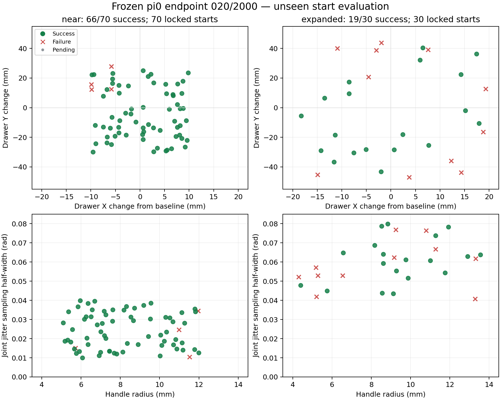
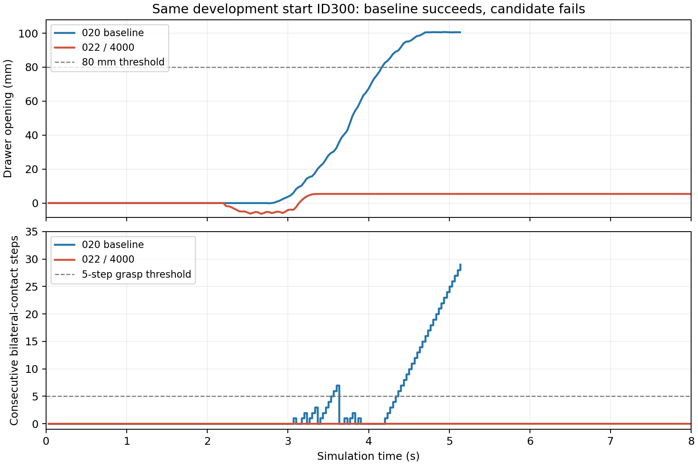

# 扩范围抓取修复与最终独立验收（2026-11-02）

**本轮训练没有取得合格升级，继续推荐020/2000。** 已完成清理、失败诊断、补充训练数据、021/022训练与开发筛选、最终独立100起点测试及重放复核。

## 训练与筛选结果

| 权重 | 原train12/10/9/11 | 新near8 | 新expanded8 | 筛选合计16 | 决定 |
| --- | --- | --- | --- | --- | --- |
| 020/2000 | 历史同权重已通过，本轮不重复 | 8/8 | 7/8 | 15/16 | 保留 |
| 021/2000 | 2/4 | 未执行 | 未执行 | 未执行 | 不进入新筛选 |
| 021/4000 | 0/4 | 未执行 | 未执行 | 未执行 | 不进入新筛选 |
| 022/2000 | 4/4 | 5/8 | 6/8 | 11/16 | 未达到升级标准 |
| 022/4000 | 4/4 | 7/8 | 6/8 | 13/16 | 未达到升级标准 |

021采用30个新训练场景增加接触阶段反馈，共7647查询；原train四起点回归后，022加入020在全部10个train起点上的325条成功预测保留标签，样本采样权重12，合计7972查询。两轮均从020开始、学习率3e-6、4000步、保存2000/4000步，cached端点、夹爪权重4、局部位置权重0.5。最初计划的022学习率1e-5未执行；修订见[amendment022.json](amendment022.json)，原协议保留。

新增专家场景尝试48个，30个完整专家与反馈专家通过；专家失败不证明物理不可达。训练参考验收仅筛选训练数据，开发/最终起点没有按模型或专家成功过滤。7972查询不是7972条独立轨迹。所有标签和梯度来自原10个train父起点，原物理validation/eval_only、开发16和最终100均不用于训练。

022恢复了四个旧起点的通过，但没有在开发16上超过020，未执行新候选的完整33回归或最终100。4/4不能写成33/33，未执行不计失败。020历史完整33/33仍有效，原020/4000和/6000未在本轮评估。

## 020最终新100起点结果

完成时间：2026-11-02T19:28:47.226653+08:00。起点400—499，seed2026110207；开发起点300—315，seed2026110206。最终100在模型训练前锁定，模型选择在首次最终测试推理前冻结。

| 分组 | 成功 | 成功率 | Wilson 95%区间 |
| --- | ---: | ---: | --- |
| 原范围新组合 | 66/70 | 94.3% | 86.2%—97.8% |
| 扩大范围新组合 | 19/30 | 63.3% | 45.5%—78.1% |
| 预定70/30混合 | 85/100 | 85.0% | 76.7%—90.7% |

上一批起点200—299的结果为84/100（66/70、18/30）。本批为85/100（66/70、19/30），**权重相同，不能把分数差异当作本轮训练带来的提升**。合计率只代表预定70/30混合；两组范围、起点与置信区间分别保留。

成功时仿真耗时中位数5.17秒，最长23.70秒；仿真在推理期暂停，不代表真机实时性能。实际6795次推理合并p50/p95为142.88/146.60ms，区别于各trial分位数的中位数。

失败分类：{"single_finger": 13, "grasp_slip": 2}。single_finger表示未满足连续5步双指各>.01N，并非全过程只有一指接触。峰值超过80mm也不能替代完整判据。

100条独立重放全部证据有效，位置、速度、接触力最大误差见[一致性审计](completion_audit.json)。权重21个推理文件前后一致，运行源码及锁定清单检查通过；专家运行动作与中途状态注入均为0。最终测试后未再调参或换权重。

## 运行条件与范围

沿用双指各>.01N连续5步、接触拉动、开度≥80mm保持30控制步；open任务、24秒上限、固定噪声42、H4、continuous夹爪、checkpoint原精度、GLFW软件渲染、每条独立进程。

near：X相对基准±10mm，Y±30mm，把手半径5—12mm，关节扰动采样半宽.01—.04rad。expanded：X±20mm，Y±50mm，把手半径4—14mm，采样半宽.04—.08rad。X基准场景偏移.10m；实际关节扰动受关节/控制限位约束。多个因素同时变化，不能做单因素归因。

同一模拟器、任务、相机和ready姿态来源，不能推断任意场景、真实机器人或关闭往返成功率；当前策略仍是π0骨干一步确定性改造版，原多步flow未验收。

## 失败对比与证据

最终100起点的参数与成败分布如下；绿点成功、红叉失败，多个参数同时变化，图中位置不能单独解释成败原因。



[开发集成对诊断](candidate_failure_comparison.md)显示，部分022回归样本在相同初态和噪声下，初始目标仅差几毫弧度，随后发生毫米至厘米级轨迹差异；这不证明单一关节差异是唯一原因。



[逐条参数与结果CSV](starts_and_outcomes.csv)、[指标JSON](metrics.json)、[独立重放](baseline020_final100_independent_replay.json)、[候选记录](candidates.json)、[初始协议](protocol.json)、[冻结模型指纹](frozen_final_models.json)。

数据审计：[021数据](training_data_full_audit.json)、[022数据](022_training_data_full_audit.json)、[021梯度](021_gradient_audit.json)、[022梯度](022_gradient_audit.json)、[训练场景覆盖](training_reference_coverage.json)。

[清理报告](../project_cleanup_20261102/README.md)：释放9.70GiB，原11份展开模型、原始数据和评估证据保留；新候选另外保存4份，当前共15份完整检查点。原始预处理缓存需要时可重建。优化日志原始19915字节前缀校验一致，其后按时间追加新记录。

原始最终轨迹：`logs/a2_pi0/grasp_improvement_20261102/baseline020_final100/`。模型推荐未升级，后续若继续训练需另留新的独立最终起点，不把本批再次称为未见过的测试集。

## 复现本轮模型与起点

使用本机GPU与未使用过的输出目录；这是复测既有起点，不是新增独立样本。

```bash
.venv/bin/python scripts/a2_pi0/run_drawer_eval_isolated.py \
  --checkpoint checkpoints/pi0_openarm_drawer_endpoint_v001/feedback_endpoint_020_randomized_rehearsal/2000 \
  --manifest data/processed/openarm_drawer_eval_v004_final/manifest.json \
  --no-eval-manifest --weight-precision checkpoint \
  --task open --seconds 24 --seed 42 --action-chunk 4 \
  --output logs/a2_pi0/grasp_final100_reproduce_001
```
