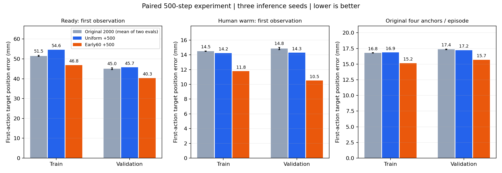
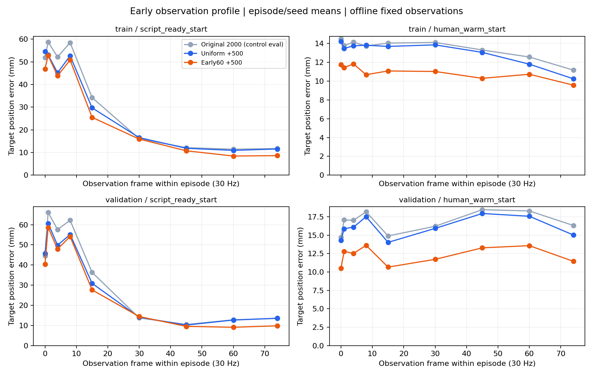

# 起步采样对照：完整结果

已完成两组各500步训练、加密离线评估和四次12秒真实闭环。结论：本轮早期采样改善离线位置预测，但未解决闭环接近/抓握失败。

## 训练与离线评估

均匀对照和early60实验组均从success13_lora_001/2000开始，重新初始化优化器；峰值3e-6、warmup50、500步cosine。仅改变早期采样比例。两组逐步轨迹选择相同，未被替换的帧相同；1000次更新均数值有限且参数更新非零。
实际前15帧观测抽样7→59次，前75帧59→329次。评估使用120 train/36 validation固定帧和三种子。

| 验证位置误差mm（三种子均值） | uniform +500 | early60 +500 |
|---|---:|---:|
| ready首帧 | 45.721 | 40.306 |
| human warm首帧 | 14.288 | 10.506 |
| 原四帧检查点总体 | 17.219 | 15.689 |

同起始权重的两次评估存在最多0.962mm的分组位置均值差异，具体原因未确认；未将其伪装成逐位一致。各自训练前值和变化量之差见[完整离线表](offline_results.md)。本轮只有一个训练随机种子，不能作为多次训练的统计显著性证据。

## 真实闭环

固定train ID12/ID8、seed42、每次执行4步、每条12秒。四轮均完整执行360步；无专家动作或中途状态注入；四轮均无把手接触、无抽屉拉开。独立执行原示教前4步可精确重现原qpos。

| 执行4步后的实际夹持点相对同刻示教偏差mm | 原2000模型 | uniform +500 | early60 +500 |
|---|---:|---:|---:|
| ready ID12 | 93.294 | 100.577 | 92.770 |
| human warm ID8 | 20.256 | 18.418 | 14.322 |

加权组ready执行4步仍偏离约93mm，与原2000模型相近；人工起点虽然前4步偏差下降，到第30步仍偏离同刻示教约211mm。离线变好没有转化为稳定闭环。12秒仅用于早期行为诊断，不构成完整任务、多种子成功率测试。

## 日志与产物

- 均匀训练：`logs/a2_pi0/drawer_success_20261024-170454-891158/`。
- 早期训练：`logs/a2_pi0/drawer_success_20261024-171400-933179/`。
- 两组均已在原生窗口每100步刷新loss，并保存各自`loss_curve.png/.svg`。
- 均匀闭环：`logs/a2_pi0/success_live_20261024-172316-402307/`。
- 早期闭环：`logs/a2_pi0/success_live_20261024-172607-839553/`。
- 每个闭环trial包含`closed_loop.mp4`、`closed_loop.npz`、`summary.json`。
- 数值对照：[control_closed_loop.json](control_closed_loop.json)、[early_closed_loop.json](early_closed_loop.json)。
- 新权重在`checkpoints/pi0_openarm_drawer_success_v003_lora/{success13_uniform500_control_002,success13_early60_500_003}/500`，500是本轮更新数。

## 后续诊断建议

剩余大误差集中在ready前0～8帧。下一步先做这些帧的单起点拟合诊断，确认能否把最初动作学准，再判断需要更强的起步采样、动作/输入诊断或偏离状态的纠偏数据。本轮不支持“增加一点早期采样即可恢复任务成功”的结论。
